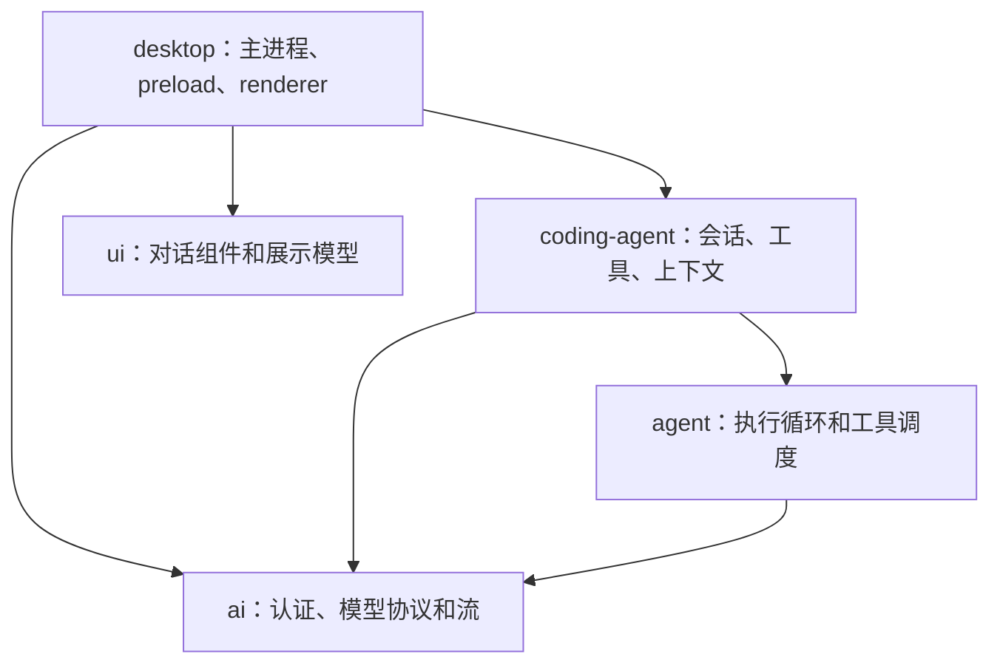
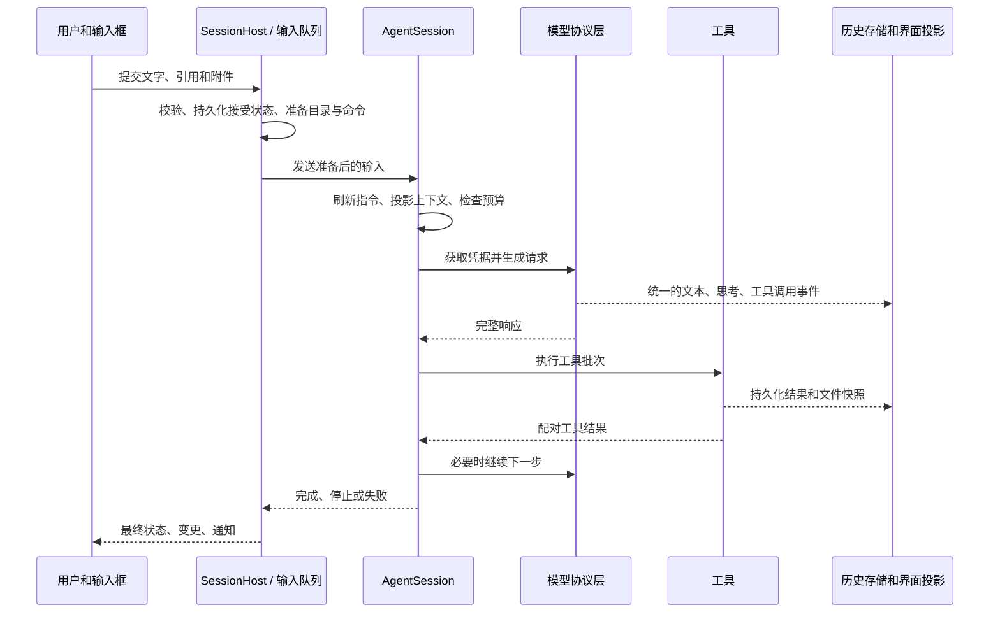

# 总览设计与模块地图

ZPI 是本地运行的编码桌面客户端。用户选择项目、模型和任务，模型通过工具读取和修改工作区，客户端把执行过程、文件变更与结果呈现在同一界面中。本文解释整体边界及阅读路线；每项功能的操作和实现分别由独立页面维护。

## 阅读路线

| 目的 | 路线 |
| --- | --- |
| 第一次使用 | [新手向导](features/getting-started.md) → [模型接入](features/models.md) → [对话操作](features/conversations.md) → [变更审查](features/review.md) |
| 查询功能 | [根索引](../README.md)的功能列 → 对应原理列 |
| 理解执行核心 | 本文 → [Agent 循环](internals/agent-loop.md) → [工具](internals/tools.md) → [上下文](internals/context.md) |
| 排查连接 | [诊断](features/diagnostics.md) → [认证](internals/openai-auth.md) → [WebSocket](internals/openai-websocket.md) → [恢复](internals/recovery.md) |
| 修改桌面功能 | [进程边界](internals/runtime.md) → 对应功能原理 → [源码地图](internals/module-map.md) → [测试](features/testing.md) |

## 产品边界

核心内置工具只有 `read`、`write`、`edit`、`bash`。桌面通过通用扩展接口接入提问、子智能体、联网工具和后台命令。核心和 SDK 不依赖 Electron。

项目没有内置 MCP、遥测、专用 REPL 或 Agent 浏览器控制工具。浏览器面板由用户操作；Agent 可以经 `bash` 使用工作机器已经具备的脚本和依赖。

主任务、辅助对话、子智能体可拥有独立对话状态，但辅助对话和子智能体共享父任务工作目录。Git 工作树隔离检出文件；工作目录和提示词都不构成操作系统权限沙箱。

## 五个包

| 包 | 负责 | 入口 |
| --- | --- | --- |
| `ai` | 协议、消息事件、认证原语、缓存、媒体投影、模型发现 | [stream.ts](../packages/ai/src/stream.ts)、[types.ts](../packages/ai/src/types.ts) |
| `agent` | 请求模型、执行工具、消费排队指令、结束运行 | [agent-loop.ts](../packages/agent/src/agent-loop.ts) |
| `coding-agent` | 会话装配、资源、四工具、历史、压缩、运行设置 | [sdk.ts](../packages/coding-agent/src/core/sdk.ts)、[agent-session.ts](../packages/coding-agent/src/core/agent-session.ts) |
| `ui` | 对话、Markdown、输入、工具卡片、查找、预览解析 | [index.ts](../packages/ui/src/index.ts) |
| `desktop` | 持久状态、会话编排、原生窗口、IPC、桌面界面 | [main/index.ts](../packages/desktop/src/main/index.ts)、[App.tsx](../packages/desktop/src/renderer/App.tsx) |

## 一次输入如何成为结果

普通工具在完整响应后执行；符合只读并发条件的流式工具可以提前开始，但必须收到显式工具参数结束事件。工具日志先持久化，完成结果只消费一次。详情见[工具调度](internals/agent-loop.md)。

## 状态归属

| 状态 | 所有者 | 保存方式 |
| --- | --- | --- |
| 项目、任务、分组、设置、草稿、队列 | 主进程 `StateStore` 及各服务 | `state.sqlite` |
| 会话事实、工具日志、压缩边界 | 会话层，桌面通过 `HistoryStorage` 写入 | JSONL v2 |
| 历史偏移、搜索和投影索引 | 历史 Worker | 可重建的 `history.sqlite` |
| API Key 和 OAuth 凭据 | `SettingsStore` | 系统加密文件；加密不可用时留在内存 |
| 当前执行、取消、WebSocket 续接 | `AgentSession` 和连接管理器 | 进程内存 |
| 标签、选区、阅读位置和显示状态 | renderer store、pane store、组件 | 按用途使用内存或本地偏好 |
| PTY、原生浏览器和快速浮窗 | 主进程桌面服务 | 原生资源，按生命周期销毁 |

历史、模型上下文和界面时间线是三种视图：完整事实留在 JSONL；模型看到有效上下文；界面分页读取并按需挂载。压缩不等于删除原始对话，界面虚拟化也不等于限制全部历史内存。

## 功能和原理的覆盖边界

根索引为每个主题提供成对入口。[源码地图](internals/module-map.md)把文件归到原理页面，包括协议转换、缓存、重试、存储迁移、原生桥接和测试设施。

功能页维护入口、步骤、可见行为、作用域和排错。原理页维护调用链、状态归属、协议与数据结构、并发、取消、恢复及源码和测试依据。数值规则由解释其机制的页面维护，其他页面链接过去。

## 关键取舍

- 小工具集与桌面能力分层，SDK 可独立使用。
- 主进程掌握文件、进程、网络和持久化能力，preload 提供有限类型接口。
- 首次发送冻结桌面能力；修改选择不重配已经开始的请求。
- 原始历史和派生索引分离，重建索引不改写事实；业务数据库不能按缓存删除。
- 模型恢复与工具恢复分开，避免网络重试隐式重放修改和命令。
- 同一功能只维护一份当前规则，外部参考项目的历史实现不覆盖本项目代码。

## 维护范围

文档解释仓库实现。外部模型目录、额度和协议是否可用由实际账号与服务端决定。[测试文档](features/testing.md)区分本地自动化、Electron 和系统/线上验证，历史测试数量不作为当前通过证明。

源码变化时更新对应功能和原理页；新增模块进入源码地图。`AGENTS.md` 后续从实际代码和稳定开发约定重新生成。
