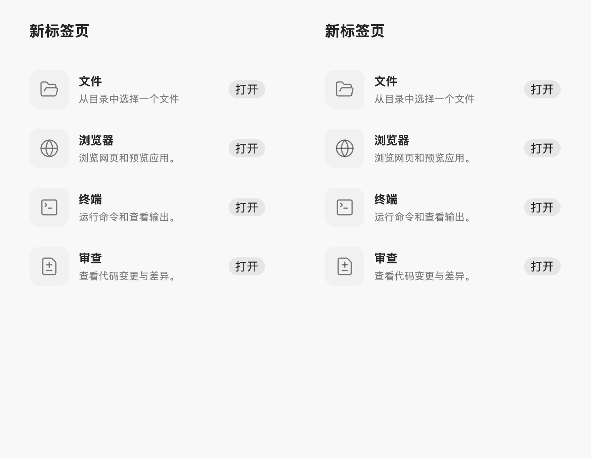
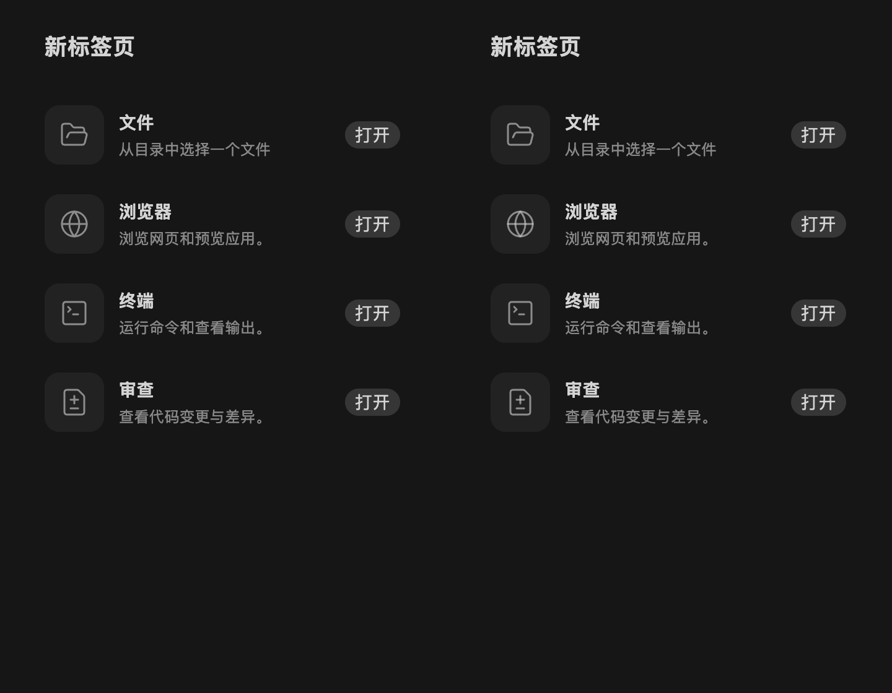
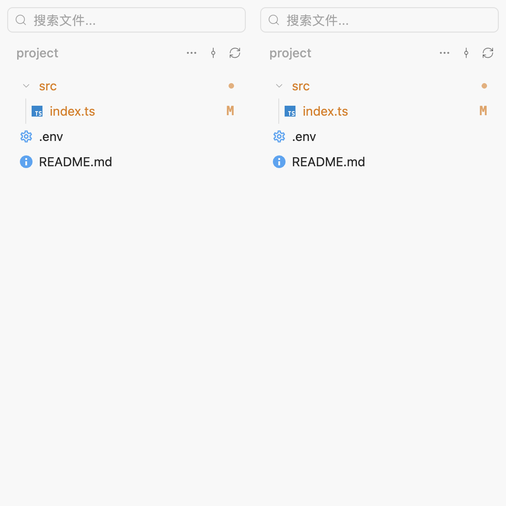
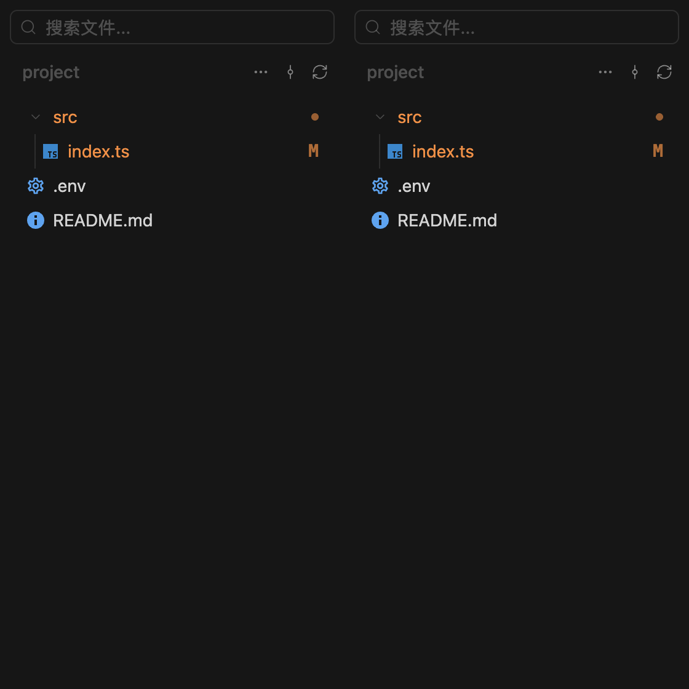

# 文件管理与草稿目录验收

参考仓库：`/Users/jiezhou/VSCodeProjects/ZCode`，提交 `3c5b227649371507ddc4eb46ac5133afe6db1cab`。

本次完成右侧文件入口与目录/预览组合页、独立草稿目录，以及内置应用入口的顺序和卡片布局。未引入远程项目、多目录 roots 或插件市场。

## 行为验证

- 新标签页按文件、浏览器、终端、审查、辅助对话排列，后两项遵循现有可用条件；加号打开真实标签页，启动应用替换入口标签的位置。
- 文件夹图标保持不变，选择文件后标签标题变成文件名。目录搜索与懒加载缓存分开；Git 状态、变更过滤、deleted 虚拟文件、展开/压缩目录、监听自动刷新和手动刷新已验证。
- 文件预览在左、目录在右，共用一行标头；使用与参考相同版本的 `react-resizable-panels` 4.10.0，支持拖动、键盘调整、分栏比例持久化、目录显隐记忆及窄栏切换。
- 独立文件标签不互相导航；迟到读取、关闭标签及后台任务回包不会抢占其他任务。首次发送切换到 Git 工作树后，原文件标签保留原目录目标，新标签使用新工作目录。
- 文件右键添加到聊天与拖拽引用复用 Markdown mention，不自动发送请求。现有预览格式和共享文件候选索引沿用 ZPI 的实现。
- 新无项目草稿使用 `~/.zpi/workspace/draft-<session UUID>`，恢复已有草稿或重启复用 cwd，新任务使用不同目录；项目目录和显式继承 cwd 的任务不变。已有目录丢失时读取报错，不通过读取静默重建。

验证命令与结果：

- `npm run check`：通过，保留原有 4 个警告与 6 条提示。
- `npm run build`：通过。
- `npm run test:unit`：277 个文件通过，3517 项通过，1 项跳过。
- 相关桌面回归：`file-manager`、`browser-presentation`、`conversation-interactions`、`capabilities`、`workspace-appearance` 共 23 项通过。
- 最终标题与提示交互更新后：`pane-isolation.test.ts` 46 项通过；`file-manager.spec.ts` 2 项通过。
- `git diff --check`：通过。

## 视觉对照

复现：`node scripts/verify-file-manager-parity.mjs /Users/jiezhou/VSCodeProjects/ZCode`。

使用真实 ZCode 入口行和文件树组件及其样式，与 ZPI 组件分别打包，再在隔离、隐藏的 Electron 窗口中截图。语言、平台、工具提示及文件树数据边界使用测试适配，真实文件读写、监听、搜索、预览与草稿恢复另由桌面测试覆盖。分栏使用相同版本库与参数；下方生产截图来自实际 ZPI 测试进程。

16 组局部对照覆盖明暗主题、14/20px 字号；入口宽度 360/600px，文件树宽度 192/280px。测量的布局坐标、宽高、字体及 SVG 路径全部一致。以 RGB 任一通道相差超过 16/255 统计，入口仍有 87–92 像素微差，文件树有 13–16 像素微差，集中于少数图标边缘；未将结果记作逐像素完全一致。完整摘要见 [visual-summary.json](visual-summary.json)。

以下对照均左为 ZCode、右为 ZPI：

## 实际界面

[明色文件面板](panel-light.png) · [暗色文件面板](panel-dark.png) · [窄栏完整界面](narrow-dark.png)

测试数据全部位于独立临时目录，使用假模型服务；未读取用户真实任务、剪贴板或启动外部应用。
