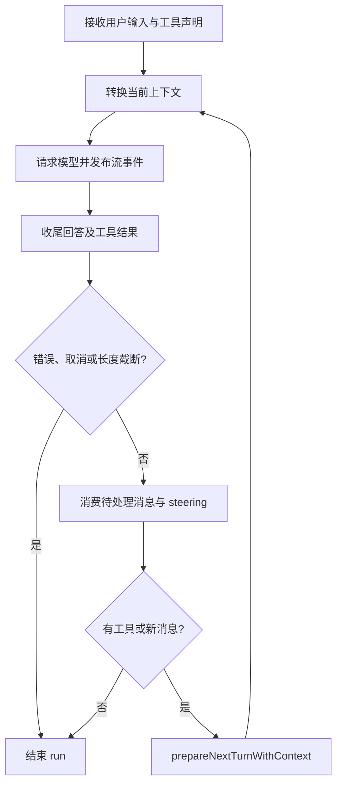

# Agent 循环与工具调度

使用入口：[对话](../features/conversations.md)、[基础工具](../features/tools.md)。

## 一次用户输入为什么会调用多次模型

Agent 在一次 run 中重复“请求模型 → 接收完整回答 → 执行工具 → 将结果送回模型”。一次模型回答称为一个 turn；它可能只包含文字，也可能声明多个工具调用。run 在没有工具或待处理消息时结束，也会因停止、错误或长度截断结束。

## 核心与宿主边界

`packages/agent` 只知道消息、工具和事件。`convertToLlm` 负责把宿主消息转成模型消息；`transformContext` 可以变换请求视图；`prepareNextTurnWithContext` 在下一轮前更新上下文。桌面存储、问答 UI、子智能体和进程管理都不在这个包中。

开始执行时比较当前声明和工具集合，写入工具新增/移除的 system 消息，避免历史中的工具定义被静默改变。`continue` 要求最后的模型可见消息是 user 或 toolResult，不能无条件续接一条已完成的助手回答。

## 普通工具批次

先按模型声明顺序校验工具存在、执行 `prepareArguments`、用 TypeBox 验证参数，再调用 `beforeToolCall`。被阻止、未知工具、无效参数直接生成失败结果，不执行工具和 `afterToolCall`。

默认可以并行执行一个批次，但所有 preflight 按声明顺序准备；结果按声明顺序追加到上下文。全局 `toolExecution: sequential` 或批次里任一工具要求顺序执行时，改为逐个执行。

执行器串行发布工具进度，工具结束后等待已排队的进度通知，再运行 `afterToolCall`。扩展返回的 details 必须是可 JSON 序列化的数据。进度通知失败不能抹掉已执行工具的结果；持久化或事件接收器故障则向上终止，不能伪装成功。

## 流式提前执行

收到 `toolcall_end` 才考虑提前执行，保存参数的深拷贝，不用持续变化的 partial。只有同时满足只读、并发安全、无破坏性、无需批准、无需用户交互、sideEffectScope 为 none 的工具才有资格。

如果可用工具集合中存在顺序工具，整个流式推测执行关闭，防止后面才声明的顺序调用改变前面的执行顺序。写文件、运行 shell、结构化提问等不能因为参数看起来完整就提前运行。

## 中断、重复 ID 与收尾

同一个回答里的重复 tool call ID 会被识别，保留唯一声明并将回答标记为错误。停止和恢复会取消流式协调器，最多等待 250 毫秒收尾。已得到结果的调用保留；未启动的标记 `not_executed`；已启动而结果不明的标记 `unknown_execution_state`，提示检查实际状态，不能盲重试。

每个已声明调用都必须有结果，哪怕结果是取消。这样后续模型不会看到没有对应 result 的孤立调用。恢复后的协调器不沿用旧执行句柄。

## 消息邮箱的真实边界

子智能体结果等 pending messages 在请求前和一个完整 turn 结束后被消费。正文、推理或工具参数中间不会为邮箱强行切断响应。即便本轮只输出文本，结束时仍检查邮箱；存在消息则再调用模型。run 已结束后才到达的消息留给后续输入消费。

## 源码与回归入口

- [Agent 状态](../../packages/agent/src/agent.ts)、[循环](../../packages/agent/src/agent-loop.ts)、[执行器](../../packages/agent/src/tool-execution.ts)、[流式协调器](../../packages/agent/src/streaming-tool-coordinator.ts)。
- [流式工具测试](../../packages/agent/test/streaming-tools.test.ts)、[邮箱测试](../../packages/agent/test/pending-messages.test.ts)、[进度失败测试](../../packages/agent/test/tool-progress-failure.test.ts)。
