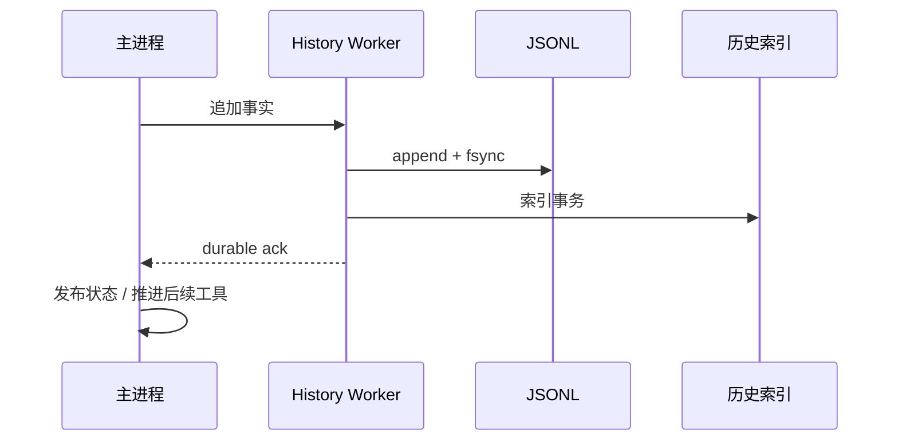

# 对话事实、History Worker 与懒加载

使用入口：[历史与备份](../features/storage.md)，上层状态见[会话](sessions.md)。

## JSONL 是事实，索引可重建

transcript v2 记录递增 seq、run、model call、工具 journal、context anchor 等。标题、置顶、当前模型选择与输入队列属于业务数据库。历史索引保存偏移、运行摘要和查询数据，帮助分页与查找，不取代原始 JSONL。

SessionManager 的当前上下文和 renderer 的历史页是不同投影。已经压缩的上下文只需摘要及后缀，但用户仍能翻阅以前记录；未压缩长会话的有效模型上下文仍可能需要完整加载。

## 写入屏障

Worker 为会话串行化写操作。先落文件再更新索引，收到 durable ack 才推进依赖该事实的步骤。索引失败时，JSONL 可能已有尾部；必须阻止继续追加，重开并重建索引，不能把同一事实无脑再追加一次。

主进程对历史数据库以只读查询为主，耗时解析和写入留在 Worker。线程失败需要拒绝等待中的操作并保留已落盘事实，不能只让 UI 等到超时后显示成功。

## 替换、分叉和恢复

重建历史先准备目标 generation/spool，按记录界限校验，再发布替换结果。每条记录也有上限，不能因为总文件分块就允许单行无限大。批量替换失败保留旧 generation。

工具 journal 记录流式执行与完成结果，崩溃后恢复 orphan/unknown 状态。fileChange 的完整快照与 UI 的截断 diff 分开，所以日志预览省略不等于回退依据也丢失。

## 分页

首屏/历史页按最近模型调用组织，通常目标为最近 10 次调用，2 MiB 软预算、8 MiB 硬预算，并对单条超大记录做特殊处理。根据行偏移读取，避免启动时对全部历史构建巨大数组。

辅助对话继承前缀有隐藏水位，模型可用而 UI 不重复呈现。搜索命中可定位并加载目标页；renderer 再做[可见 turn 虚拟化](rendering.md)，两层分别控制读盘和 DOM 成本。

冷启动索引重建仍有实际成本。懒加载改善常规打开，不承诺任意损坏或未索引的大文件都能瞬间恢复。性能脚本生成测量结果，旧日期的 benchmark 文件已从文档移除，不能当作当前版本验收值。

源码：[Worker](../../packages/desktop/src/main/history-worker.ts)、[存储协调](../../packages/desktop/src/main/history-storage.ts)、[索引](../../packages/desktop/src/main/history-index.ts)、[v2](../../packages/desktop/src/main/transcript-v2.ts)、[核心 transcript](../../packages/coding-agent/src/core/transcript-store.ts)。回归：[写屏障](../../packages/desktop/test/history-write-barrier.test.ts)、[批量替换](../../packages/desktop/test/history-bulk-replace.test.ts)、[查询计划](../../packages/desktop/test/history-query-plan.test.ts)、[懒加载](../../packages/coding-agent/test/lazy-session-store.test.ts)。
