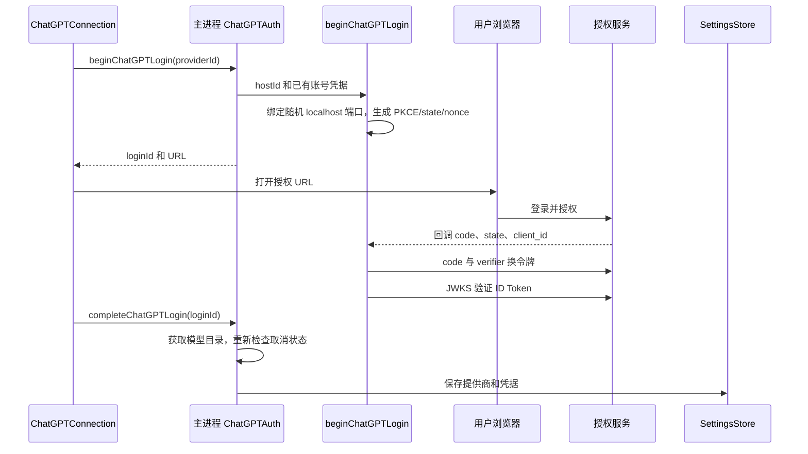

# ChatGPT 登录与令牌生命周期

对应功能：[模型与账号](../features/models.md)。OAuth 协议原语在 `ai`，桌面登录事务与凭据存储在主进程。API Key 接入不经过这条登录和刷新路径。

## 所有者与调用链

`ChatGPTAuth.pending` 在等待回调监听器建立之前先占位，防止两个 IPC 同时开启登录。complete 有独立 completing 标记，取消通过删除当前 attempt 使后续异步结果失效。

## 授权请求

源码固定 issuer `https://auth.openai.com`，resource `https://api.openai.com/v1`。这是当前客户端实现的接口，不是通用 OAuth 服务发现器。

| 参数 | 实现 |
| --- | --- |
| 授权路径 | `/api/accounts/authorize` |
| 初次 client_id | `dynamic_agent_client`，另传 `agent_name_hint=ZPI` |
| 返回账号 | 复用已发放 clientId，拒绝换成另一 clientId |
| 安装身份 | `ext_agent_host_id`，校验 UUID v4 URN 格式 |
| PKCE | 32 字节随机 verifier，SHA-256 后 base64url，`S256` |
| state / nonce | 各自独立 32 字节随机值 |
| scope | openid、profile、email、offline_access、resource.invoke、chatgpt.tokens.use.direct |
| 回调 | `http://127.0.0.1:<随机端口>/auth/callback` |

监听器绑定回环地址，只接受 GET。回调要求 origin、pathname、state 匹配；显式拒绝、缺少 code/clientId、重复回调或已取消登录都不能继续。手动粘贴回调也进入同一验证函数。

服务端回调成功页只表示收到了回调，不表示凭据已经验证和保存。总登录期限默认五分钟；超时或取消中止令牌请求并关闭监听连接。

## 令牌和身份校验

令牌交换向 `/api/accounts/oauth/token` 发 form-urlencoded POST，禁止重定向，单次期限 20 秒。返回值必须有非空 access/refresh、正的有限 expires_in 和 scope；token_type 若存在必须为 bearer，并包含套餐直接使用范围。

`verifyChatGPTIdentity` 用 `jose` 从 issuer 的 JWKS 地址取签名密钥，按 fetch 实例缓存 resolver。校验 RS256、issuer、audience，以及 sub/exp/iat；首次登录还校验 nonce。重登已有账号必须保持 subject 一致。

凭据包括 access、refresh、到期时间、clientId、subject、idToken、scopes 和可选 email。公共设置只投影账号状态，不广播令牌。目录发现失败转为 warning，成功登录仍可保存；发现期间取消则不保存。

## 请求前刷新

`ModelRuntime` 为 ChatGPT 提供 `getApiKey`，每次请求调用 `SettingsStore.getRequestApiKey`：

1. 提供商必须仍存在，access 和 refresh 必须可用。
2. 同一提供商已有刷新 Promise 时，所有请求共享它。
3. 身份不待验证、令牌不等于本次被拒令牌、且到期还超过三分钟时直接使用。
4. 否则刷新；若已经有待验证的轮换凭据，只继续验证，不再次交换 refresh token。
5. 成功或失败后清理该 Promise，且只清理仍是当前拥有者的记录。

取消某个等待者不会取消共享刷新，但该等待者返回后再次检查取消信号，不能发出迟到模型请求。

## refresh token 轮换与持久化顺序

刷新请求使用 refresh_token grant、已有 client_id 和 resource。轮换可能立即使旧 refresh token 失效，因此新 access/refresh **先保存，再进行新增的身份网络验证**。

若返回新 id_token，设置 `identityPending=true`。新身份通过验证且 subject 与原账号一致后，移除 pending 并保存。JWKS 暂时不可达时保留待验证凭据，重启后可以继续验证；不能继续用尚未验证的新身份发模型请求。

保存回调比较当前 access/refresh 是否仍等于本次预期值。退出、删除或重新登录改变凭据后，旧刷新不能覆盖新状态。系统加密不可用时同样保持内存状态规则，但不明文落盘。

## 401 和退出

AI 请求层只在第一次尝试、没有有效输出且错误内容为空的 401 上请求一次强制刷新；只有获得不同令牌才重新发请求。同一轮不无限续期，API Key 不自动刷新。已有输出后的 401 交给上层失败路径。

退出先使本地令牌失效并取消对应待登录流程，然后向 `/api/accounts/oauth/revoke` 撤销 refresh token。撤销单次期限五秒，最多一次额外重试。远端失败不恢复本地登录，返回无法确认撤销的 warning；clientId 和主体身份可保留用于返回登录校验。

## 错误与测试

授权错误只将已知错误码和 HTTP 状态纳入诊断，任意服务器正文不直接进入日志。invalid_grant 等提示重登；临时授权服务失败与客户端配置错误分别提示。

源码：[协议](../../packages/ai/src/auth/openai-chatgpt.ts)、[桌面事务](../../packages/desktop/src/main/chatgpt-auth.ts)、[凭据存储](../../packages/desktop/src/main/storage.ts)、[401 请求恢复](../../packages/ai/src/stream.ts)。

回归：[身份与轮换](../../packages/desktop/test/chatgpt-auth.test.ts)、[取消](../../packages/desktop/test/chatgpt-cancellation.test.ts)、[请求刷新](../../packages/ai/test/chatgpt-refresh.test.ts)。测试使用假授权服务和签名材料，不证明真实账号额度或线上授权资格。
