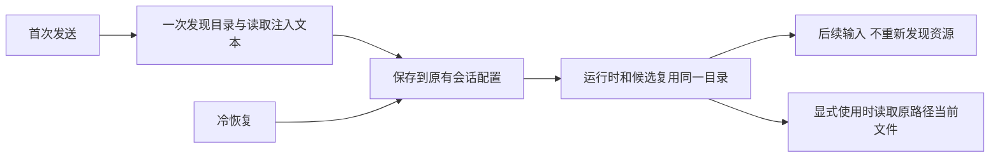

# 指令、技能与系统提示加载

使用入口：[上下文和技能](../features/context.md)。应用读取用户和项目中的 AGENTS.md、技能及插件资源，形成当前会话的系统材料。

## 固定发现顺序

`FileResourceLoader` 按以下顺序加载，后面的技能同名定义可以覆盖前面的：

1. `~/.agents/AGENTS.md` 与 `~/.agents/skills/`。
2. `~/.zpi/AGENTS.md` 与 `~/.zpi/skills/`。
3. `cwd/AGENTS.md` 与 `cwd/.agents/skills/`。
4. `cwd/.zpi/AGENTS.md` 与 `cwd/.zpi/skills/`。

这是固定根列表，不向上遍历所有父目录，也不递归搜项目里每一个 AGENTS.md。关闭项目资源会跳过后两组。指令和技能可并行读取，但最终顺序稳定，失败产生资源诊断。

## 技能发现和按需加载

技能根下只检查直接子目录或目录符号链接的 `SKILL.md`，名称排序后处理。先扫描 frontmatter，按 1 KiB 块读取，头部上限 64 KiB；不会为了展示候选就把每个技能全文塞进系统提示。

文件须为普通文件，YAML 使用唯一键和 alias 数量限制。描述长度为 1–1024，技能名称应与父目录名一致。realpath 用来识别同一文件的路径别名。后加载的同名技能获胜；获胜项被禁用后，不回退启用较早同名项。

列表返回副本，实际使用时重新读取并解析正文。系统提示只带技能元数据和路径；路径经过 XML 转义，技能中的相对资源引用以 SKILL.md 所在目录为基准。

## 系统提示合成

核心基础模板描述通用编码行为和工具。资源加载完成后加入指令及技能索引。SDK 的 `customInstructions` 可以是字符串数组，或返回字符串数组的同步函数；函数在资源加载后求值。它不是模板语言，不执行字符串中的任意表达式。

自定义 loader 的 `getBaseInstructions` 可以替代基础指令，`getInstructions` 添加补充指令。交互方式、多工具调用、文件链接格式、文件内容复用和主动推进由独立内置插件贡献 instructions，项目初始化插件提供 `/init`；首次发送固定其注入文本与启用配置。协作插件贡献动态类型列表与协调提醒，当前项目资源由宿主加载。组件通过[统一装配入口](plugins.md)进入提示预览和实际会话。

## 刷新、禁用与出错

桌面会话首次发送时确定资源目录和启用状态、技能元数据、已展示的子智能体目录信息、自定义命令目录项，以及需要注入的用户和项目指令、记忆文本。这些数据直接写入原有 `frozenConfiguration.resources`，随会话配置持久化；不新增资源版本库或清单。工作树会话在工作树准备完成后、模型请求前确定。之后发送、冷恢复、压缩和回退均沿用这些信息；分叉、辅助对话和子智能体继承来源配置，不重新发现资源。

SessionHost 是会话资源配置的唯一所有者；运行时和已有会话的输入候选使用同一目录。普通后续输入、冷恢复和已有会话候选查询不再扫描 AGENTS.md、技能、子智能体、记忆或命令目录，也不自动追加文件变化。开关和目录的修改影响新建独立对话；已经注入的指令和记忆继续使用保存的文本。已经读入历史消息的内容沿用正常会话历史。

技能配置只保存名称、描述、原路径等元数据，不提前加载正文或遍历其引用目录。Agent 按需直接读取原路径的当前 SKILL.md、引用文件和脚本；文件修改后读到最新内容，删除后正常报不存在。命令目录项和启用状态固定，显式调用时只重读该命令当前模板，不重新扫描目录；沿用原有准备期间变更检查和执行校验。子智能体目录同样只保留名称、描述、来源路径和启用状态，不提前保存未注入的角色、模型和权限。显式启动时读取对应单个文件；已经启动的子会话沿用自己的角色配置和历史。没有技能目录复制、内容摘要缓存、路径重写或历史文件保留机制。

草稿候选按需发现当前资源。文件搜索、文件 `@` 和会话 `#` 引用等用户主动入口按需查询；实际调用解析参数、读取引用和执行 Shell。窗口获焦不为所有历史会话重新发现资源。Hook 的实际执行、插件执行前完整性校验和任务状态更新不属于资源发现，继续遵循原契约。

旧会话缺少 resources 配置时不扫描、不补建，也不自动注入当前磁盘资源。目录候选缺失就保持缺失，不解析历史正文重建索引。已有历史系统块通过 SDK 的 preserveSystemContext 模式原样保留，不重建或撤回；必要模型、工具和子任务执行状态继续从已有配置恢复。空的运行时目录和记忆状态用于阻止后续 prompt hook 再次发现资源，不写入新的资源配置。输入接受前的失败不能固定草稿配置。不存在文件与格式错误要区分：不存在是可选资源缺失，坏 YAML、非法 metadata、读取失败应显示诊断。

验收覆盖旧会话有无历史资源正文时均不补扫、已注入正文不被撤回、子智能体单文件读取和已有子会话续跑，以及资源修改和删除、开关修改、运行时重建、分叉/子智能体继承，以及技能、引用文件和命令的按需读取；以发现调用计数验证后续输入、冷恢复和已有会话候选查询不扫描资源目录。独立 SDK 的动态 ResourceLoader 与动态上下文协议保持可用；桌面传入固定目录和注入文本的加载器，其 loadSkill 仍读取当前文件。

资源正文属于提供给模型的指令内容，并不赋予操作系统权限。技能不能让 SDK 获得 Electron，也不改变 shell 可访问的目录范围。工作目录、工具选择和桌面插件快照分别由各自状态 owner 管理。

## 源码与回归入口

- [加载器](../../packages/coding-agent/src/core/resources.ts)、[系统提示](../../packages/coding-agent/src/core/system-prompt.ts)、[内置插件](../../packages/builtin-plugins/src/index.ts)、[设置界面](../../packages/desktop/src/renderer/ResourceSettings.tsx)。
- [会话资源回归](../../packages/desktop/test/session-resource-config.test.ts)、[发现测试](../../packages/coding-agent/test/resource-discovery.test.ts)、[技能测试](../../packages/coding-agent/test/skills.test.ts)、[自定义指令](../../packages/coding-agent/test/custom-instructions.test.ts)、[桌面资源](../../packages/desktop/test/resources.test.ts)。
